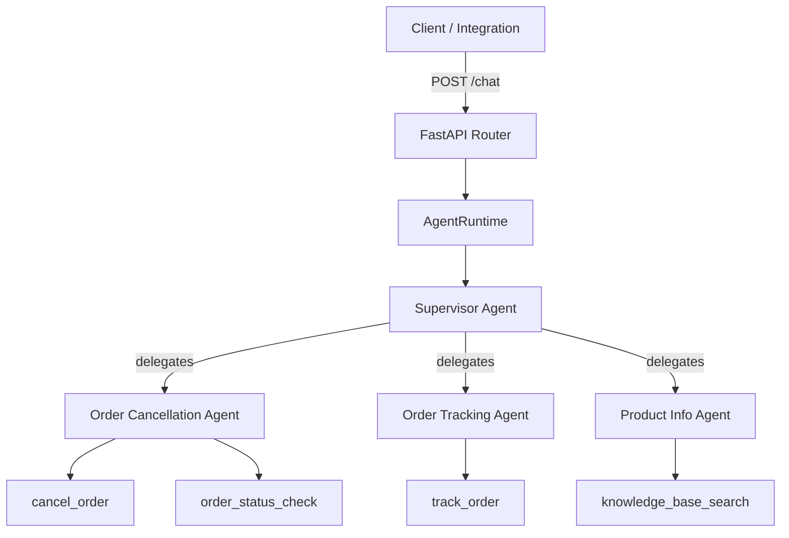
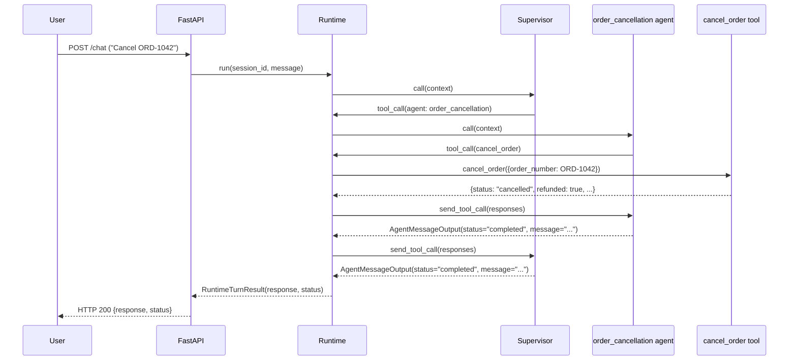

# Zendesk E-commerce Multi-Agent Assistant

This repository provides a multi-agent service that handles typical e-commerce support requests.

## Quick Start

### Local development
1. Install dependencies: `uv sync`.
2. Create a `.env` file and add your OpenAI credentials
3. Launch the API with live reload: `make start_dev` (runs `uv run uvicorn app.main:app --reload`).
4. visit `http://localhost:8000/docs` for the API documentation.

### Docker Compose
1. Create a `.env` file and add your OpenAI credentials
2. Start the full stack (app + Jaeger) with `make up`.
3. The API is available on `http://localhost:8000`; Jaeger’s UI for traces is exposed through `http://localhost:7999`.


## Manual testing scenarios

### Order cancellation
- Eligible window: ask to cancel `ORD-1042`
- Past the 24h window: ask to cancel `ORD-2735`

### Order tracking
- Active shipment: ask to track `ORD-1042`
- Near delivery: ask to track `ORD-2735`
- Pending dispatch: track `ORD-8899`

### Order status lookups
- Processing: request status for `ORD-1042`
- Shipped: request status for `ORD-2735`
- Preorder hold: request status for `ORD-8899`

### Knowledge base search
- Policy question: ask "What is your return policy?"
- Cancellation rules: ask "How long do I have to cancel an order?"
- Shipping delays: asl "carrier delay escalation"


## Architecture
### General approach

We follow a supervisor-and-specialist model: the supervisor owns the conversation end to end and invokes specialised agents as tools so it retains control over tone, routing, and when to return a response to the user.

`AgentRuntime` is the central execution layer. It wires the supervisor, specialised agents, tools, LLM client, and conversation memory for each turn.

Each agent is defined by its prompts and the tools it may call; agents stay stateless and focused on their specific domain.


### Logical components


### Order cancellation turn walkthrough


### Multi-turn state management
Conversation history is persisted per `session_id` using `InMemoryConversationStore`. Each turn appends the user message before agent invocation and the supervisor’s final reply afterwards. Agents consume a read-only `ConversationHistoryView`, which renders prior turns into XML-like markup used inside prompts. Swapping the backing store (for Redis or a database) only requires a new `ConversationStore` implementation.

## Agents and tools
**Supervisor**
- Routes requests to specialised agents when topics match supported policies.
- Rewrites specialist responses to maintain Zendesk tone.

**Specialised agents**
- `order_cancellation`: validates order IDs, checks eligibility via `order_status_check`, and finalises cancellations via `cancel_order`.
- `order_tracking`: ensures order format, fetches tracking data via `track_order`.
- `product_info`: runs keyword matching through `knowledge_base_search` and summarises results.

**Tools (`app/tools/`)**
- `cancel_order.py`: deterministic eligibility checks and canned cancellation outcomes.
- `order_status_check.py`: internal fulfilment status lookup used by the cancellation agent.
- `track_order.py`: mock carrier updates, including checkpoint history and ETAs.
- `knowledge_base_search.py`: keyword search across a mock knowledge base.

## Structured output contracts
Agents always emit `AgentMessageOutput` when finishing a turn:

```json
{
  "status": "completed",
  "user_message": "string"
}
```

`status` is one of:
- `completed`: request resolved successfully.
- `requires_input`: more user data required before proceeding.
- `failed`: the agent or tool encountered an error it could not recover from.
- `not_responsible`: the request falls outside the agent’s scope.

`POST /chat` accepts:

```json
{
  "session_id": "abc123",
  "message": "I need to cancel ORD-1042"
}
```

And returns:

```json
{
  "response": "Your order ORD-1042 was cancelled and refunded.",
  "status": "completed"
}
```

All agents share this contract so the runtime can treat every response uniformly, keep telemetry consistent, and swap specialists without changing orchestration logic.

## Observability
- Records structured application logs and OpenTelemetry traces for every turn.
- Review logs via the service output and inspect traces through Jaeger at `http://localhost:7999` when using Docker Compose.

## Limitations and future work
1. **LLM interface** – The abstraction could support other providers, but right now it leans on OpenAI behaviour and only implements the bare minimum of structured output and tool-calling. Retries, configurable models, and streaming are not implemented.
2. **Testing** – There are no automated tests yet. Dependency injection throughout the runtime and tools should make it straightforward to add unit and integration suites.
3. **Memory depth** – We only store user and supervisor messages; tool call transcripts and richer metadata are still missing.
4. **User identity** – Sessions are keyed by `session_id` only. There is no authentication layer or user concept.
5. **Tool registry** – Tools are registered inline. A dynamic registry or MCP-style discovery would make integrations more resilient.
6. **Prompt engineering** – Prompts handle the demo scenarios but are not hardened against adversarial prompts or edge cases.
7. **Error handling** – There is no retry logic for misrouted agents or runaway delegation, and avoiding circular calls currently depends on prompt discipline.
8. **Async execution** – Tool calls are sequential. An async runtime has not been implemented.

## Design discussion
**Supervisor pattern**  
Keeping a single supervisor in charge means the tone stays consistent and we have a clear place to retry if a specialist declines a request. The downside is the extra hop: every response has to travel back through the supervisor even when a specialist already nailed the answer, so there is one more component that can fail.

**Swarm-style approach (not implemented)**  
Letting specialists hand work to one another would remove that extra hop and might shorten some conversations. The trade-off is higher complexity—each agent would need awareness of its peers, guardrails against loops get harder, and the tone is no longer owned by a single prompt.

We stick with the supervisor-first design because it keeps governance, tone, and routing logic in one place. Moving to a swarm model would mostly mean rewriting prompts and runtime policies, but we would also need stronger safeguards before trusting it in production.
